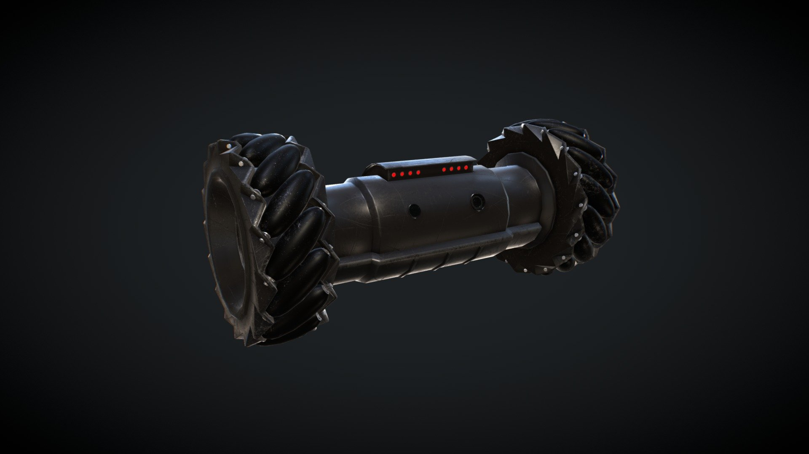
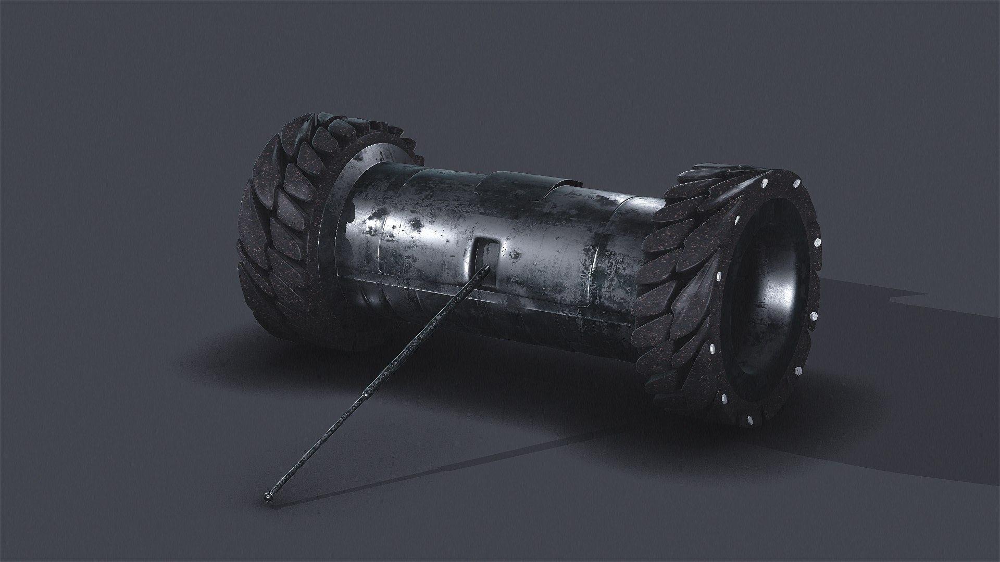

# R6S Recon Scout — Analog FPV Ground Robot

A miniature differential-drive ground robot inspired by the Recon Scout from Rainbow Six Siege, built around analog 5.8GHz FPV drone components for low-latency video and long-range RC control.

**ESC firmware patch** ([Session 006 log](docs/logs/2026-03-28-session-006-wheel-redesign-and-ESC-firmware-patch.md))
- **Problem:** the two BLHeli_S ESCs engaged at different stick positions.
- **Fix:** the settings bytes (throttle range, center, direction, startup power) were patched directly in the stock Intel HEX file, record checksums recalculated, and one file flashed per ESC.
- **Result:** on the bench the motors started at closer, but not identical, stick positions; sync has not been measured yet.

## Project Overview

**Goal:** Build a functional miniature FPV ground robot matching the dumbbell form factor of the R6S Recon Scout, using off-the-shelf drone electronics for real-world performance.

**Why This Project:**
- Apply drone electronics knowledge to a ground robotics platform
- Achieve low-latency analog FPV video on a custom-built recon robot, driven by real-life law enforcement applications and inspired by the R6S Recon Scout
- Design and 3D print a compact dumbbell chassis from scratch
- Document the full hardware integration process — wiring, ESC flashing, TX configuration
- Build a fun, capable RC robot as a counterpart to more software-heavy portfolio projects

## Hardware Platform

### Core Components
- **Chassis:** Custom 3D-printed dumbbell form factor
- **Drive Motors:** 2× 2212 920KV Brushless Motor (2S rated, operator-owned)
- **ESCs:** 2× HSKRC OPTIO 20A BLHeli_S 16.7 (A-H-25) (flashed to bidirectional mode)
- **Receiver:** FlySky FS-iA6B (6CH, AFHDS 2A, iBUS/PPM)
- **Transmitter:** FlySky FS-i6X (10CH, AFHDS 2A — operator-owned)
- **Camera + VTX:** AKK BA3 5.8GHz 40CH AIO, 200mW, 600TVL
- **FPV Goggles:** 5.8GHz receiver goggles (operator-owned)
- **Power:** 2× 2S 800mAh 50C LiPo in parallel (1600mAh total, operator-owned)
- **UBEC:** UBEC-3A 5V Mini BEC 2–6S DC-DC Converter (operator-owned)
- **RC Light Bar:** 32PCS LED Roof Lamp, 100mm, 5V–8.4V — 3 modes: On, Breathing, Strobe

### Technical Specifications

| Component | Specification |
|-----------|---------------|
| **Form Factor** | Dumbbell — two wheel hubs, central barrel, rear stabilizer stem |
| **Barrel Diameter** | ~40mm |
| **Total Width** | ~150mm + (wheel thickness × 2) |
| **Drivetrain** | Differential steering, 2WD brushless direct-drive |
| **Motor KV** | 920KV |
| **Battery** | 2× 2S 800mAh 50C in parallel — 7.4V nominal, 1600mAh, JST |
| **Est. Runtime** | ~10–12 min at normal driving loads |
| **ESC Signal Protocol** | PWM, 1000 to 2000µs (BLHeli_S bidirectional mode; BLHeliSuite names its throttle range settings "PPM") |
| **RC Protocol** | AFHDS 2A (2.4GHz) |
| **Video Protocol** | Analog 5.8GHz, 40 channels, up to 200mW |
| **Video Latency** | <30ms (analog) |
| **Camera Resolution** | 600TVL |
| **Telemetry** | Battery voltage via AFHDS 2A back-channel |

### Power Architecture

| Component | Power Source |
|-----------|-------------|
| ESCs | 2S LiPo main lead (parallel pack) |
| Receiver | 2S LiPo main lead — direct connection enables accurate voltage telemetry |
| AKK BA3 VTX + Camera | UBEC 5V regulated output (within BA3 operating range: 3.3–5.5V) |
| RC Light Bar | FS-iA6B receiver — 5V channel output (within light bar operating range: 5V–8.4V) |

## Chassis Design

The robot matches the R6S Recon Scout's dumbbell silhouette:

- **Wheel hubs:** Each hub houses one 2212 920KV brushless motor directly. The motor mounts to the barrel end cap via 4× M3 bolts on two 16mm and two 19mm bolt circles.
- **Barrel:** Central cylinder containing the ESCs, receiver, UBEC, and all wiring. The AKK BA3 camera faces forward through the front face of the barrel.
- **Rear stem:** Passive ground-contact leg that resists motor reaction torque — without it, the body would rotate in the opposite direction of the wheels rather than the wheels driving the robot forward.

### Body Structure

The barrel assembly consists of four 3D-printed pieces:

| Piece | Function |
|-------|----------|
| **Main Body** | Primary electronics housing — ESCs, receiver, UBEC, all wiring |
| **Main Body Cap** | Forward-facing face of the barrel — mounts AKK BA3 camera and antennas |
| **Battery Cover** | Removable panel providing frequent-access battery compartment |
| **Rear Stem** | Separate piece attaching above the Battery Cover — passive stabilizer leg |

All inter-piece joints use **M3×6×5 brass heat set inserts**: 4.2mm hole diameter, 7.2mm hole depth, 9.35mm outer wall diameter.

## Current Status

**Last Updated:** November 16, 2026

**Status:** Frozen to focus on a separate rover project; no build sessions since Session 006 (2026-03-28). The robot drives under power but is not controllable: the wheels lose traction as soon as they turn, and top speed is too high.

### Completed Milestones

**Planning & Design:**
- ✅ System architecture defined — pure analog FPV, no onboard computer
- ✅ Motor and ESC selection finalized (2212 920KV + HSKRC OPTIO 20A BLHeli_S bidirectional)
- ✅ Receiver selected (FS-iA6B, confirmed AFHDS 2A telemetry support)
- ✅ Camera selected (AKK BA3 AIO — fits barrel form factor)
- ✅ Chassis concept designed — dumbbell form factor matching R6S reference
- ✅ Full BOM sourced and purchased
- ✅ All hardware received

**Electronics:**
- ✅ ESC programming approach confirmed — BLHeliSuite + Arduino Uno as 4-way interface
- ✅ ESCs flashed to bidirectional mode (ESC1: Bidirectional, ESC2: Bidirectional Reversed)
- ✅ FS-iA6B receiver bound to FS-i6X transmitter
- ✅ Elevon mix configured on FS-i6X — 100% travel, Rate 100, Expo 70
- ✅ ESC PWM calibration complete (Min 1000µs, Center 1500µs, Max 2000µs)
- ✅ ESC startup tuning complete — Low RPM Power Protect off, Startup Power high, Demag Compensation low, Motor Timing high
- ✅ Full wiring completed
- ✅ Motor response inconsistency addressed in Session 006: ESC firmware patched at the hex level, one file per ESC; motors started at closer, but not identical, stick positions on the bench (not yet measured)
- ✅ Startup Power retuned to 11 (1.00) after flashing (Session 006)

**Mechanical:**
- ✅ Body v1 printed in PLA — motor fitment confirmed
- ✅ Body redesigned around actual ESC dimensions
- ✅ Heat set insert cavity specification established (4.2mm dia, 7.2mm depth, 9.35mm outer wall)
- ✅ Body, body cap, and battery cover printed in PETG
- ✅ Wheels and rear stem printed in TPU
- ✅ Full assembly completed
- ✅ Wheel redesign completed in Session 006: 70mm diameter, 2mm spike tread, reprinted in TPU

**Testing:**
- ✅ First wheel prototype printed (PLA — geometry check)
- ✅ First drive test completed — motor torque failure identified and resolved
- ✅ Second drive test completed — robot moves under power

**Pending:**
- ⏳ Traction: the 70mm wheels still slip as soon as they turn
- ⏳ Top speed too high to control
- ⏳ ESC sync measurement (straight-line drift test); blocked until traction is fixed, since slipping wheels hide any ESC mismatch
- ⏳ Battery compartment redesign: batteries currently need full rear stem disassembly to reach
- ⏳ Wheel material testing (TPU baseline complete — further iterations pending)
- ⏳ Requirements verification (drop, runtime, splash resistance)

### Known Design Considerations

- **FS-iA6B antenna:** Must not be enclosed in a solid printed shell. Route antenna wire to exit through the barrel wall.
- **Battery connector:** 2S packs use JST — verify ESC power lead connector before wiring.
- **Motor direction:** ESC1 set to `Bidirectional`, ESC2 to `Bidirectional Reversed`. Getting this wrong results in one wheel driving backward — correct in BLHeliSuite, not by swapping motor wires.
- **VTX power level:** Drop to 25mW indoors to avoid multipath interference. 200mW for outdoor use.
- **Variable speed limiter:** Left stick throttle axis reserved for a future speed limiter feature. The FS-i6X cannot implement this natively — a microcontroller between the receiver and ESCs would be required.

## Documentation

- [Bill of Materials](docs/bill-of-materials.md) — Complete parts list with suppliers and costs
- [Build Log](docs/logs/0000-build-logs.md) — Session-by-session assembly and testing journal

## Author

**Arsham Faghihnasiri**

Building robots and learning real hardware engineering end-to-end.

- 📍 Greater Toronto Area, Ontario, Canada
- 💼 [LinkedIn](https://www.linkedin.com/in/arsham-faghihnasiri)
- 📧 arshamfaghihnasiri@gmail.com
- 🎓 Software Engineering

## License

[Creative Commons Attribution-NonCommercial 4.0 International (CC BY-NC 4.0)](LICENSE)

You are free to share and adapt this project for personal and non-commercial use with attribution. Commercial use of this design or derivatives requires explicit written permission from the author.
