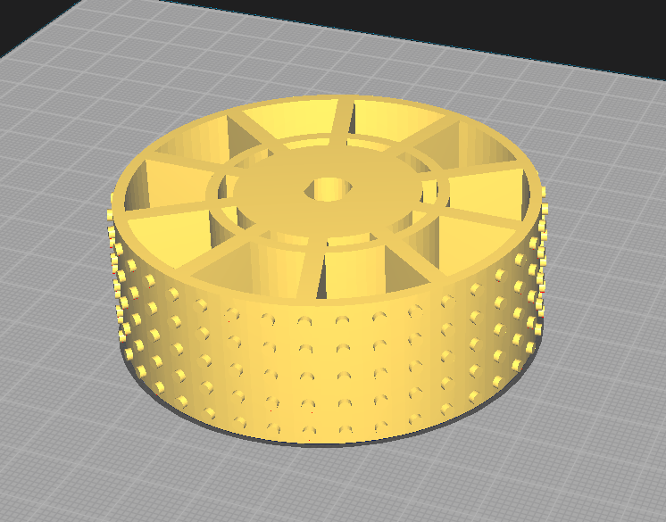

# Session 006 — Wheel Redesign & ESC Firmware Patch

**Date:** 2026-03-28  
**Status:** ✅ Complete

---

## Goal

Resolve the two issues identified in Session 005: near-zero traction from the
original 90mm wheels, and ESC desync (the two motors starting at different stick
positions).

---

## What Was Accomplished

1. Wheels redesigned — simpler geometry, 70mm diameter, 2mm spike tread pattern
2. New wheels printed in TPU and installed
3. ESC desync attributed to PPM endpoint relearning on power-up (corrected below)
4. BLHeliSuite "Programming by TX" fix attempted — setting greyed out, non-editable
5. Compile-from-source approach attempted — blocked by Keil 8051 free tier 2KB
   code size limit
6. Toolchain established: Simplicity Studio v4 + Keil 8051 9.60
7. EEPROM section of stock hex file patched directly to lock PPM endpoints and
   motor direction
8. Two patched hex files produced and flashed via BLHeliSuite
9. Post-flash startup power tuned — settled at value 11 (1.00)
10. ESCs appeared to be running in sync on the bench; full drive test deferred

---

## Wheel Redesign

The original 90mm TPU wheels produced near-zero traction on the test surface.
Two contributing factors: the large diameter created excessive top speed for
indoor use, and the contact patch was too narrow to generate meaningful grip.

The new design addresses both:

- **Diameter reduced to 70mm** — lower top speed, better torque utilisation at
  the wheel contact patch
- **Simplified profile** — removed unnecessary geometry from the hub
- **2mm spike tread pattern** — spikes deform slightly under load and bite into
  the surface, increasing effective grip.

Wheels reprinted in TPU and installed. Traction saw a clear improvement over the
previous design.


Before: 90MM Wheel

After: 70MM Wheel

---

## ESC Desync: Corrected Finding

**Original hypothesis.** The two motors started at different stick positions. A
BLHeliSuite read in Session 005 showed PPM values of 1148/1488/1832µs, which were
taken to be values the ESCs had learned. The working theory became that BLHeli_S
relearned its PPM throttle endpoints on every power cycle, so the two ESCs ended
up with different values.

**What the source shows.** The BLHeli_S 16.7 source
([`BLHeli_S.asm`](https://github.com/bitdump/BLHeli/blob/a5bcf99312e2c7c9e79ccd8051e4633f954f8a1a/BLHeli_S%20SiLabs/BLHeli_S.asm))
does not support that theory:

- In bidirectional mode, the arming code skips TX programming and throttle
  calibration entirely
  ([lines 3796 to 3800](https://github.com/bitdump/BLHeli/blob/a5bcf99312e2c7c9e79ccd8051e4633f954f8a1a/BLHeli_S%20SiLabs/BLHeli_S.asm#L3796-L3800)).
- In normal mode, calibration only runs on the first arming after power-up, with
  TX programming enabled and the stick above mid (lines 3803 to 3836).
- 1148/1488/1832µs are the stock `DEFAULT_PGM_MIN_THROTTLE`,
  `DEFAULT_PGM_CENTER_THROTTLE` and `DEFAULT_PGM_MAX_THROTTLE` values
  ([lines 324 to 326](https://github.com/bitdump/BLHeli/blob/a5bcf99312e2c7c9e79ccd8051e4633f954f8a1a/BLHeli_S%20SiLabs/BLHeli_S.asm#L324-L326)),
  not learned values.

With both ESCs set to bidirectional (Session 003), the firmware never runs the
calibration routine, so it could not relearn endpoints at power-up.

**Most likely cause (not confirmed).** The two ESCs were running different stored
settings. For example, if the manual 1000/1500/2000µs values from Session 005 did
not end up saved on both ESCs, one would still use the stock 1148/1488/1832µs
range and start at a different stick position. Whether those values were saved
and read back from both ESCs was not recorded.

**Why the patch still helped.** Flashing the patched hex wrote the same settings
page to both ESCs (only the Direction byte differs) and did not change any
firmware code, so both ESCs started from identical throttle settings. After
flashing, the motors started at closer, but not identical, stick positions. The
remaining difference has not been investigated.

---

## Fix Attempts — What Didn't Work

**Attempt 1 — BLHeliSuite "Programming by TX" checkbox**

In BLHeliSuite, the "Programming by TX" setting controls whether the ESC accepts
throttle calibration from the transmitter signal. Disabling it would lock the
stored PPM values permanently. However, this checkbox was greyed out and could not
be changed via BLHeliSuite. The likely reason is bidirectional mode: the BLHeli_S
16.7 source skips TX programming entirely when Direction is bidirectional (see
Corrected Finding above). This approach was abandoned.

**Attempt 2 — Compile from source**

The correct fix at the firmware level is to patch the EEPROM default values in
the source before compilation. The toolchain for BLHeli_S SiLabs firmware is
Simplicity Studio + Keil 8051.

- Ride7 + RKit-51 tested first — version incompatibility, rejected
- Simplicity Studio v3 — too old, rejected
- Simplicity Studio v4 + Keil 8051 9.60 installed successfully at:
  `C:\SiliconLabs\SimplicityStudio\v4\developer\toolchains\keil_8051\9.60\BIN`

However, Keil 8051's free tier enforces a 2KB compiled code size limit. BLHeli_S
exceeds this limit, so compilation fails. Purchasing a Keil license to compile a
single firmware patch is not justified. Compile-from-source was abandoned.

---

## Fix — Direct EEPROM Hex Patch

Since compiling from source was blocked, the pre-built stock hex file
(`A_H_25_REV16_7.HEX`) was patched directly at the EEPROM segment addresses.

BLHeli_S keeps its settings in a flash page at `0x1A00` (the "EEPROM" segment),
which the firmware reads on every boot. Patching those bytes in the hex file sets
the values both ESCs start with after flashing. BLHeliSuite's Write Setup writes to
the same page, so later changes (such as the startup power tuning below) replace
the patched bytes. If the page is ever invalid, the firmware rewrites it from its
compiled-in defaults, not the patched values.

### EEPROM Byte Patch Table

| EEPROM Address | Parameter | Stock Value | Patched Value | Notes |
|----------------|-----------|-------------|---------------|-------|
| `0x1A09` | Startup_Pwr | `0x09` (0.50) | `0x08` (0.38) | Reduced slightly — 0.50 was too aggressive on new 70mm wheels |
| `0x1A0B` | Direction | `0x01` (Normal) | `0x03` or `0x04` | ESC1 → Bidirectional (0x03), ESC2 → Bidirectional Reversed (0x04) |
| `0x1A19` | Min_Throttle | `0x25` (→ 1148µs) | `0x00` (→ 1000µs) | Locks min endpoint to match FS-i6X actual output |
| `0x1A1A` | Max_Throttle | `0xD0` (→ 1832µs) | `0xFF` (→ 2020µs) | Maximum storable byte value. The FS-i6X tops out at 2000µs, so full forward stick gives roughly 96% forward throttle; full reverse is unaffected |
| `0x1A21` | Center_Throttle | `0x7A` (→ 1488µs) | `0x7D` (→ 1500µs) | Locks center point to true neutral |

The formula for converting the stored byte to microseconds is `4x + 1000 = µs`.

**Startup_Pwr:** the "too aggressive" startup was seen at the Session 005 setting
of 1.50, not at the stock 0.50. The flashed `0x08` (0.38) did not last: after
flashing, Startup Power was raised in steps and settled at 11 (1.00) via Write
Setup (see Post-Flash Startup Power Tuning), which overwrites this byte.

After patching each byte, the Intel HEX line checksum was recalculated and updated
to ensure the file is valid. BLHeliSuite validates checksums on read — an
incorrect checksum causes a read failure.

### How the Addresses Were Located

The stock hex file and a description of the problem were given to an AI assistant
(Claude), which identified the five bytes to patch and generated the two patched
files.

The addresses were later cross-checked against the BLHeli_S 16.7 source
([bitdump/BLHeli](https://github.com/bitdump/BLHeli), `BLHeli_S SiLabs/BLHeli_S.asm`).
The settings block starts at `CSEG AT 1A00h`, with one byte per setting at a fixed
offset:

| Address | Source label |
|---------|--------------|
| `0x1A09` | `Eep_Pgm_Startup_Pwr` |
| `0x1A0B` | `Eep_Pgm_Direction` |
| `0x1A19` | `Eep_Pgm_Min_Throttle` |
| `0x1A1A` | `Eep_Pgm_Max_Throttle` |
| `0x1A21` | `Eep_Pgm_Center_Throttle` |

All five offsets match, and the stock bytes in `A_H_25_REV16_7.HEX` match the
`DEFAULT_PGM_*` values in the source. In the hex file these bytes sit in three
records, starting at `0x19FD`, `0x1A0D` and `0x1A1D`. Those are the only records
the patch changes.

### Checksum Recalculation

Each Intel HEX record ends with a checksum byte: the two's complement of the low
byte of the sum of every byte before it (byte count, address, record type and
data). A valid record therefore sums to `0x00`, and changing any data byte means
recomputing that record's checksum.

Worked example: the Center_Throttle record, line 345 of the stock
`A_H_25_REV16_7.HEX` from bitdump/BLHeli.

```
Stock:   :0D1A1D0004FF02FF7AFF0701FFFF0000FF3A
Patched: :0D1A1D0004FF02FF7DFF0701FFFF0000FF37
```

- `0D` = 13 data bytes, `1A1D` = start address, `00` = data record
- Center_Throttle (`0x1A21`) is the fifth data byte: `7A` becomes `7D`
- Sum of every byte before the checksum in the patched record:
  `0D+1A+1D+00+04+FF+02+FF+7D+FF+07+01+FF+FF+00+00+FF = 0x6C9`
- Low byte is `0xC9`, so the checksum is `0x100 - 0xC9 = 0x37`

The data byte went up by 3, so the checksum went down by 3 (`3A` to `37`). The
other two changed records follow the same rule. The checksums in the flashed files
were computed when the AI assistant generated them; this example recomputes one
independently from the stock file.

### Output Files

Two separate hex files were produced — one per ESC, differing only in the
Direction byte. Both are tuned for use with the FlySky FS-i6X transmitter and
FS-iA6B receiver (AFHDS 2A, PWM output).

- `A_H_25_REV16_7_ESC1_BIDIR.HEX` — Direction: `0x03` (Bidirectional)
- `A_H_25_REV16_7_ESC2_BIDIR_REV.HEX` — Direction: `0x04` (Bidirectional Reversed)

Both files were verified with correct checksums and confirmed readable in
BLHeliSuite before flashing.

### Regenerating the Patched Files

[`tools/patch_blheli_hex.py`](../../tools/patch_blheli_hex.py) rebuilds both files
from the stock hex. Download `A_H_25_REV16_7.HEX` from
[bitdump/BLHeli](https://github.com/bitdump/BLHeli) (`BLHeli_S SiLabs/Hex files/`),
then run:

```
python tools/patch_blheli_hex.py path/to/A_H_25_REV16_7.HEX -o output/folder
```

The script refuses any file that is not the stock 16.7 A_H_25 hex, patches the
five bytes in the table above, recalculates the checksums of the three changed
records, validates every record in the output, and writes both ESC files. Its
output matches the two originally flashed files byte for byte.
[`tools/test_patch_blheli_hex.py`](../../tools/test_patch_blheli_hex.py) checks
this independently; usage is in its header.

---

## Flashing Patched Firmware

Flashing procedure was identical to Session 003, using the Arduino Uno with
PB3PB4 firmware as the 4-way interface:

1. Connect ESC signal wire to Arduino pin 11
2. Open BLHeliSuite, select SILABS BLHeli Bootloader (4way-if)
3. Click Read Setup, then connect LiPo within 1–2 seconds to catch the bootloader
   window
4. Flash patched hex file via the Flash BLHeli button
5. Read back settings to verify Direction, Min/Center/Max Throttle match patched
   values

Both ESCs flashed and verified successfully.

---

## Post-Flash Startup Power Tuning

After flashing, startup power was tuned incrementally via BLHeliSuite Write Setup
(no reflashing required):

| Value | Result |
|-------|--------|
| 9 (0.50) | Insufficient — motors hesitated under load |
| 10 (0.75) | Close — marginal hesitation on carpet |
| **11 (1.00)** | **Working well — settled here** |

Final Startup Power: **11 (1.00)**

---

## ESC Sync Verification

With both ESCs flashed and startup power tuned, the ESCs appeared to be running
in sync on the bench. Full drive testing under load was deferred to the next
available session.

---

## Next Steps

- [ ] Full drive test with patched firmware and 70mm wheels
- [ ] Measure ESC sync with a straight-line drift test: hold a fixed stick
      position over a measured distance, record sideways drift, and repeat in
      both directions
- [ ] Battery compartment redesign — current design requires full rear stem
      disassembly to access batteries, impractical given ~10-minute runtime
- [ ] Verify requirements: drop test, runtime, splash resistance
