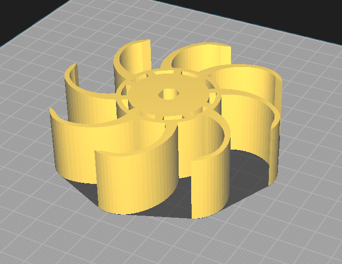

# Session 006 — Wheel Redesign & ESC Firmware Patch

**Date:** 2026-03-28  
**Status:** ✅ Complete

---

## Goal

Resolve the two issues identified in Session 005: near-zero traction from the
original 90mm wheels, and ESC desync caused by PPM endpoint relearning on every
power cycle.

---

## What Was Accomplished

1. Wheels redesigned — simpler geometry, 70mm diameter, 2mm spike tread pattern
2. New wheels printed in TPU and installed
3. Root cause of ESC desync confirmed — BLHeli_S PPM relearn behavior on power-up
4. BLHeliSuite "Programming by TX" fix attempted — setting greyed out, non-editable
   in this firmware revision
5. Compile-from-source approach attempted — blocked by Keil 8051 free tier 2KB
   code size limit
6. Toolchain established: Simplicity Studio v4 + Keil 8051 9.60
7. EEPROM section of stock hex file patched directly to lock PPM endpoints and
   motor direction
8. Two patched hex files produced and flashed via BLHeliSuite
9. Post-flash startup power tuned — settled at value 11 (1.00)
10. ESCs verified in sync; full drive test deferred

---

## Wheel Redesign

The original 90mm TPU wheels produced near-zero traction on the test surface.
Two contributing factors: the large diameter created excessive top speed for
indoor use, and the contact patch was too narrow to generate meaningful grip.

The new design addresses both:

- **Diameter reduced to 70mm** — lower top speed, better torque utilisation at
  the wheel contact patch
- **Simplified profile** — removed unnecessary geometry from the hub
- **2mm spike tread pattern** — spikes deform slightly under load and bite into
  the surface, increasing effective grip.

Wheels reprinted in TPU and installed. Traction saw a clear improvement over the
previous design.

Before: 90MM Wheel

After: 70MM Wheel

---

## ESC Desync — Root Cause

The motor speed inconsistency observed in Session 005 was caused by BLHeli_S
relearning PPM throttle endpoints on every power cycle. The firmware's default
behavior is to recalibrate min/max throttle from the incoming signal during the
arming sequence each time the ESC is powered up. Because the FS-i6X's actual
output range does not precisely match the BLHeli_S default reference range,
the two ESCs learn slightly different endpoint values on each power cycle —
causing them to disagree on what a given throttle input means.

---

## Fix Attempts — What Didn't Work

**Attempt 1 — BLHeliSuite "Programming by TX" checkbox**

In BLHeliSuite, the "Programming by TX" setting controls whether the ESC accepts
throttle calibration from the transmitter signal. Disabling it would lock the
stored PPM values permanently. However, in firmware revision A_H_25_REV16_7, this
checkbox is greyed out and cannot be changed via BLHeliSuite. This approach was
abandoned.

**Attempt 2 — Compile from source**

The correct fix at the firmware level is to patch the EEPROM default values in
the source before compilation. The toolchain for BLHeli_S SiLabs firmware is
Simplicity Studio + Keil 8051.

- Ride7 + RKit-51 tested first — version incompatibility, rejected
- Simplicity Studio v3 — too old, rejected
- Simplicity Studio v4 + Keil 8051 9.60 installed successfully at:
  `C:\SiliconLabs\SimplicityStudio\v4\developer\toolchains\keil_8051\9.60\BIN`

However, Keil 8051's free tier enforces a 2KB compiled code size limit. BLHeli_S
exceeds this limit, so compilation fails. Purchasing a Keil license to compile a
single firmware patch is not justified. Compile-from-source was abandoned.

---

## Fix — Direct EEPROM Hex Patch

Since compiling from source was blocked, the pre-built stock hex file
(`A_H_25_REV16_7.HEX`) was patched directly at the EEPROM segment addresses.

BLHeli_S stores its default configuration values in a dedicated EEPROM section
of the hex file. These values are loaded on first boot and after any settings
reset. By patching the correct bytes in the hex file before flashing, the desired
default values are baked in permanently — the ESC will never relearn from the
transmitter because it boots with endpoints already set to the correct values.

### EEPROM Byte Patch Table

| EEPROM Address | Parameter | Stock Value | Patched Value | Notes |
|----------------|-----------|-------------|---------------|-------|
| `0x1A09` | Startup_Pwr | `0x09` (0.50) | `0x08` (0.38) | Reduced slightly — 0.50 was too aggressive on new 70mm wheels |
| `0x1A0B` | Direction | `0x01` (Normal) | `0x03` or `0x04` | ESC1 → Bidirectional (0x03), ESC2 → Bidirectional Reversed (0x04) |
| `0x1A19` | Min_Throttle | `0x25` (→ 1148µs) | `0x00` (→ 1000µs) | Locks min endpoint to match FS-i6X actual output |
| `0x1A1A` | Max_Throttle | `0xD0` (→ 1832µs) | `0xFF` (→ 2020µs) | Set to maximum storable byte value — FS-i6X never outputs above 2000µs so the extra headroom is inert |
| `0x1A21` | Center_Throttle | `0x7A` (→ 1488µs) | `0x7D` (→ 1500µs) | Locks center point to true neutral |

The formula for converting the stored byte to microseconds is `4x + 1000 = µs`.

After patching each byte, the Intel HEX line checksum was recalculated and updated
to ensure the file is valid. BLHeliSuite validates checksums on read — an
incorrect checksum causes a read failure.

### Output Files

Two separate hex files were produced — one per ESC, differing only in the
Direction byte. Both are tuned for use with the FlySky FS-i6X transmitter and
FS-iA6B receiver (AFHDS 2A, PPM output).

- `A_H_25_REV16_7_ESC1_BIDIR.HEX` — Direction: `0x03` (Bidirectional)
- `A_H_25_REV16_7_ESC2_BIDIR_REV.HEX` — Direction: `0x04` (Bidirectional Reversed)

Both files were verified with correct checksums and confirmed readable in
BLHeliSuite before flashing.

---

## Flashing Patched Firmware

Flashing procedure was identical to Session 003, using the Arduino Uno with
PB3PB4 firmware as the 4-way interface:

1. Connect ESC signal wire to Arduino pin 11
2. Open BLHeliSuite, select SILABS BLHeli Bootloader (4way-if)
3. Click Read Setup, then connect LiPo within 1–2 seconds to catch the bootloader
   window
4. Flash patched hex file via the Flash BLHeli button
5. Read back settings to verify Direction, Min/Center/Max Throttle match patched
   values

Both ESCs flashed and verified successfully.

---

## Post-Flash Startup Power Tuning

After flashing, startup power was tuned incrementally via BLHeliSuite Write Setup
(no reflashing required):

| Value | Result |
|-------|--------|
| 9 (0.50) | Insufficient — motors hesitated under load |
| 10 (0.75) | Close — marginal hesitation on carpet |
| **11 (1.00)** | **Working well — settled here** |

Final Startup Power: **11 (1.00)**

---

## ESC Sync Verification

With both ESCs flashed and startup power tuned, the ESCs appeared to be running
in sync on the bench. Full drive testing under load was deferred to the next
available session.

---

## Next Steps

- [ ] Full drive test with patched firmware and 70mm wheels
- [ ] Battery compartment redesign — current design requires full rear stem
      disassembly to access batteries, impractical given ~10-minute runtime
- [ ] Verify requirements: drop test, runtime, splash resistance
